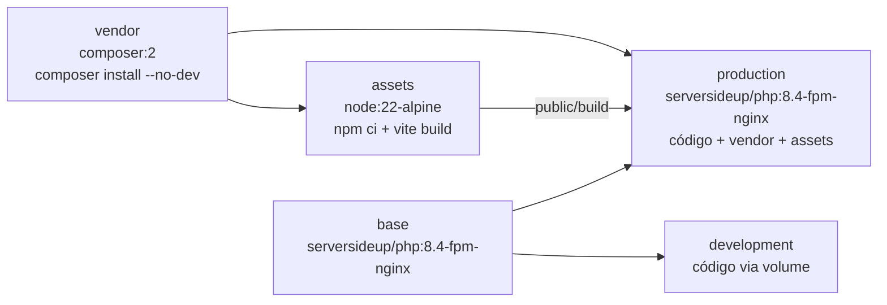

# Deploy

## Imagem Docker

O `Dockerfile` é *multi-stage*: o mesmo arquivo gera a imagem de
desenvolvimento e a de produção.



| Estágio | Faz | Vai para a imagem final? |
|---|---|---|
| `vendor` | Instala as dependências PHP sem as de desenvolvimento e gera o autoload otimizado | Só a pasta `vendor/` |
| `assets` | Instala as dependências JS e compila o front (Vue + Tailwind) com o Vite | Só `public/build/` |
| `production` | Junta código, `vendor/` e `public/build/`; liga OPcache e as migrations automáticas | É a imagem final |

Assim a imagem de produção não carrega Node, Composer, `node_modules` nem
ferramentas de teste. O `.dockerignore` impede que arquivos `.env`, `.git` e
caches locais entrem no build.

> O nome da aplicação exibido no título da aba vem do `APP_NAME` **em tempo de
> execução** (meta tag em `resources/views/app.blade.php`), porque o `.env` não
> entra na imagem e não está disponível durante o build do front.

## `docker-compose.prod.yml`

```yaml
services:
  app:
    build: { context: ., target: production }
    image: azure-facilities:latest
    container_name: azure-facilities   # nome usado pelo proxy
    restart: unless-stopped
    env_file: .env.production          # segredos, fora do git
    expose: ["8080"]                   # só para as redes Docker, não para o host
    volumes:
      - storage:/var/www/html/storage/app
    networks: [proxy, db_net]          # redes externas da VPS
```

Diferenças em relação ao `docker-compose.yml` de desenvolvimento:

| | Desenvolvimento | Produção |
|---|---|---|
| Postgres / Redis | sobem junto, em containers próprios | os da VPS, compartilhados |
| Código | montado por volume (edição ao vivo) | copiado para a imagem |
| Front | servidor do Vite com HMR | arquivos compilados |
| Portas | 8000 (app) e 5173 (Vite) no host | nenhuma — só via proxy |
| Migrations | manuais | automáticas na subida |

## Variáveis de ambiente

O modelo é o [`.env.production.example`](../.env.production.example). O arquivo
real, `.env.production`, fica só na VPS (permissão `600`, ignorado pelo git).

| Variável | Valor em produção | Observação |
|---|---|---|
| `APP_NAME` | `AzureFacilities` | Também define o nome do cookie de sessão |
| `APP_ENV` / `APP_DEBUG` | `production` / `false` | Nunca exibir stack traces |
| `APP_URL` | `https://azure.tonyhub.dev` | |
| `APP_KEY` | gerada | Criptografia de sessão e cookies — **segredo** |
| `DB_HOST` / `DB_DATABASE` / `DB_USERNAME` | `postgres` / `azure_facilities` / `azure_facilities` | Nome do container na rede `db_net` |
| `DB_PASSWORD` | gerada | **segredo** |
| `REDIS_HOST` | `redis` | |
| `REDIS_PASSWORD` | a do Redis da VPS | **segredo** |
| `REDIS_DB` / `REDIS_CACHE_DB` | `2` / `3` | Não usar 0 e 1 (outra aplicação) |
| `REDIS_PREFIX` / `CACHE_PREFIX` | `azure_facilities_` / `azure_facilities_cache_` | |
| `SESSION_DRIVER` / `QUEUE_CONNECTION` | `database` | Ficam no Postgres (durável) |
| `CACHE_STORE` | `redis` | |
| `SESSION_SECURE_COOKIE` | `true` | Cookie só trafega por HTTPS |
| `LOG_STACK` / `LOG_LEVEL` | `stderr` / `warning` | Logs vão para `docker logs` |
| `AZURE_TOKEN_KEYS` | `1:<chave>` | Chaves que criptografam os PATs — **segredo**, ver [segurança](seguranca.md) |
| `ALLOWED_EMAIL_DOMAINS` | `infortechms.com.br` | Restringe o cadastro |

## Primeira instalação (passo a passo)

Pré-requisitos na VPS: Docker, as redes `proxy` e `db_net`, e os containers
`postgres`, `redis` e `npm` rodando.

**1. Clonar o projeto**

```bash
git clone https://github.com/antoniosouza977/azure-facilities.git /root/azure-facilities
cd /root/azure-facilities
```

**2. Criar banco e usuário no Postgres compartilhado**

```bash
DBPASS=$(openssl rand -hex 24)
docker exec -i postgres psql -v ON_ERROR_STOP=1 -U <superusuario> -d postgres <<SQL
CREATE ROLE azure_facilities LOGIN PASSWORD '$DBPASS';
CREATE DATABASE azure_facilities OWNER azure_facilities;
SQL
```

**3. Criar o `.env.production`**

```bash
umask 077
cp .env.production.example .env.production
# preencher:
#   APP_URL=https://azure.tonyhub.dev
#   APP_KEY=base64:$(openssl rand -base64 32)
#   DB_PASSWORD=<a senha do passo 2>
#   REDIS_PASSWORD=<senha do Redis da VPS>
#   AZURE_TOKEN_KEYS="1:$(openssl rand -base64 32)"
```

**4. Construir e subir**

```bash
docker compose -f docker-compose.prod.yml up -d --build
docker inspect -f '{{.State.Health.Status}}' azure-facilities   # esperar "healthy"
docker exec azure-facilities php artisan migrate:status
```

**5. Configurar o proxy** (painel de administração do Nginx Proxy Manager)

- *Proxy Host* → domínio `azure.tonyhub.dev`
- *Scheme* `http`, *Forward Hostname* `azure-facilities`, *Port* `8080`
- Aba *SSL*: certificado Let's Encrypt, *Force SSL* e *HTTP/2*
- O DNS do domínio precisa apontar para o IP da VPS antes de pedir o certificado.

**6. Verificar**

```bash
curl -I https://azure.tonyhub.dev/up      # 200
curl -I http://azure.tonyhub.dev/         # 301 para https
```
