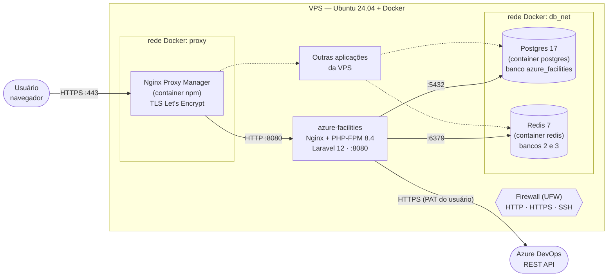
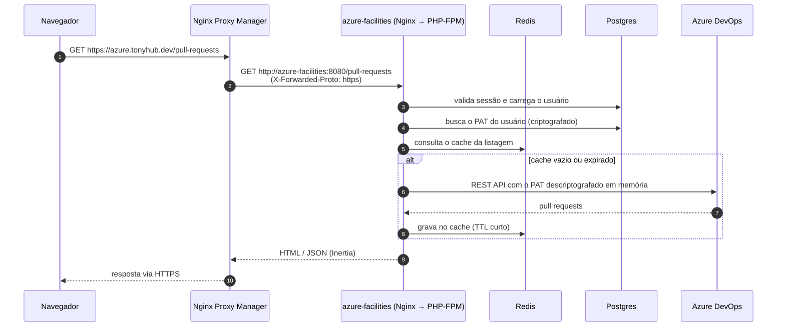

# Infraestrutura

## Visão geral

A aplicação roda numa VPS que já hospedava outros sistemas. Em vez de subir um
banco, um cache e um proxy só para ela, o Azure Facilities **reaproveita os
serviços compartilhados** da VPS e entra apenas com o container da aplicação.

O container `azure-facilities` participa de **duas redes Docker**: `proxy`
(para receber tráfego do Nginx Proxy Manager) e `db_net` (para falar com
Postgres e Redis). Ele **não publica nenhuma porta** no host: de fora da VPS só
se chega a ele através do proxy.

## Servidor

| Item | Valor |
|---|---|
| Sistema operacional | Ubuntu 24.04 LTS |
| CPU / memória / disco | 2 vCPUs · 8 GB RAM · 96 GB |
| Runtime | Docker Engine 29 + Docker Compose v5 |
| Firewall | UFW — portas liberadas apenas para HTTP/HTTPS, SSH e administração |
| Fuso horário da aplicação | `America/Campo_Grande` |

Os serviços compartilhados ficam em `/opt/stack/<serviço>`, cada um com seu
próprio `docker-compose`. O projeto fica em `/root/azure-facilities`, clonado do
GitHub.

## Serviços

| Serviço | Container / imagem | Papel para o Azure Facilities | Compartilhado? |
|---|---|---|---|
| Nginx Proxy Manager | `npm` · `jc21/nginx-proxy-manager` | Recebe HTTP/HTTPS, emite e renova o certificado Let's Encrypt, força HTTPS e encaminha para a aplicação | Sim |
| PostgreSQL 17 | `postgres` · `pgvector/pgvector:pg17` | Banco principal: usuários, sessões, tokens do Azure (criptografados) e filas | Sim |
| Redis 7 | `redis` · `redis:7-alpine` | Cache das consultas ao Azure DevOps (PRs, work items, processos) | Sim |
| **Azure Facilities** | `azure-facilities` · imagem própria | A aplicação (Nginx + PHP-FPM + Laravel) | Não |
| Portainer | `portainer` | Painel de administração dos containers | Sim (não usado pela aplicação) |

### Nginx Proxy Manager (proxy reverso e TLS)

- Único serviço com portas publicadas no host (HTTP/HTTPS e o painel de administração).
- *Proxy host* configurado para `azure.tonyhub.dev`:
  - destino `http://azure-facilities:8080` — o nome do container é resolvido
    pelo DNS interno do Docker, por isso os dois precisam estar na rede `proxy`;
  - certificado Let's Encrypt (renovação automática pelo próprio NPM);
  - *Force SSL*: requisições HTTP recebem `301` para HTTPS.
- O TLS termina no proxy; entre o proxy e a aplicação o tráfego é HTTP dentro da
  rede Docker. Por isso a aplicação confia nos cabeçalhos `X-Forwarded-*`
  (`trustProxies` em `bootstrap/app.php`) e gera URLs `https://`.

### PostgreSQL

- Instância única compartilhada; cada aplicação tem **banco e usuário próprios**.
- Para o Azure Facilities: banco `azure_facilities`, dono `azure_facilities`.
  O usuário não é superusuário e só tem acesso ao próprio banco.
- Acesso apenas pela rede `db_net` (`DB_HOST=postgres`); nenhuma porta exposta.
- Tabelas criadas pelas migrations do Laravel, que rodam automaticamente quando o
  container sobe.

### Redis

- Instância única compartilhada, com senha (`requirepass`), persistência AOF e
  limite de 256 MB com política `allkeys-lru` (quando enche, descarta as chaves
  menos usadas).
- Para não colidir com as outras aplicações, o Azure Facilities usa:
  - bancos lógicos **2** (`REDIS_DB`) e **3** (`REDIS_CACHE_DB`) — os bancos 0 e 1
    são de outra aplicação;
  - prefixos `azure_facilities_` e `azure_facilities_cache_` em todas as chaves.
- Como a política é `allkeys-lru`, o Redis é tratado apenas como **cache**:
  perder uma chave só faz a aplicação consultar o Azure DevOps de novo. Sessões e
  filas ficam no Postgres, que é durável.

## Redes Docker

| Rede | Quem participa | Para quê |
|---|---|---|
| `proxy` | `npm`, `azure-facilities` e as demais aplicações web | Proxy → aplicações |
| `db_net` | `postgres`, `redis`, `azure-facilities` e os backends das outras aplicações | Aplicações → banco e cache |

As duas redes são **externas** ao projeto: foram criadas pela infraestrutura da
VPS e o `docker-compose.prod.yml` apenas se conecta a elas
(`external: true`). Os nomes podem ser trocados pelas variáveis
`PROXY_NETWORK` e `BACKEND_NETWORK`.

## Fluxo de uma requisição

## Dentro do container da aplicação

A imagem é construída a partir de `serversideup/php:8.4-fpm-nginx`, que já
traz Nginx, PHP-FPM e as extensões necessárias (`pdo_pgsql`, `redis`, `opcache`,
`sodium`), gerenciados pelo `s6-overlay`.

| Item | Valor |
|---|---|
| Processos | Nginx (porta 8080) + PHP-FPM |
| Usuário | `www-data` (sem privilégios de root) |
| Versões | PHP 8.4 · Laravel 12 · Nginx 1.30 |
| OPcache | ligado, sem revalidar arquivos (o código só muda com nova imagem) |
| Healthcheck | `GET /up` a cada 10 s — o Docker marca o container como `healthy`/`unhealthy` |
| Reinício | `restart: unless-stopped` — volta sozinho após falha ou reboot da VPS |
| Volume | `azure-facilities_storage` → `storage/app` (arquivos enviados sobrevivem a rebuilds) |
| Na subida | limpa caches do Laravel e roda `php artisan migrate --force` |

Detalhes do build em [deploy.md](deploy.md).
