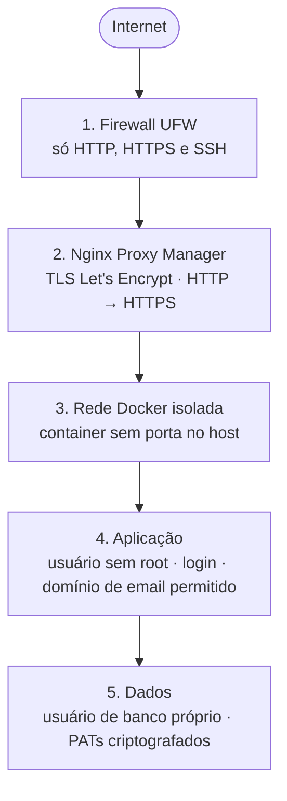

# Segurança

## Camadas

| Camada | Medida |
|---|---|
| Rede | Firewall libera só as portas necessárias. Postgres, Redis e a aplicação não têm portas publicadas no host. |
| Transporte | HTTPS obrigatório com certificado Let's Encrypt; HTTP redireciona (301). Cookie de sessão com `Secure`, `HttpOnly` e criptografado (`SESSION_ENCRYPT=true`). |
| Container | Processos rodam como `www-data`, sem root. Imagem de produção sem ferramentas de build nem dependências de desenvolvimento. |
| Aplicação | Autenticação obrigatória para todas as telas; cadastro restrito aos domínios de `ALLOWED_EMAIL_DOMAINS`; limite de tentativas de login; proteção CSRF do Laravel; `APP_DEBUG=false`. |
| Banco | Usuário `azure_facilities` sem privilégios de superusuário, dono apenas do próprio banco. |
| Cache | Redis com senha; bancos lógicos e prefixos próprios. |

## Segredos

| Segredo | Onde fica | Nunca |
|---|---|---|
| `APP_KEY`, `DB_PASSWORD`, `REDIS_PASSWORD`, `AZURE_TOKEN_KEYS` | `.env.production` na VPS (permissão `600`) | no git, na imagem Docker ou em logs |
| PATs do Azure DevOps dos usuários | Tabela `azure_tokens`, criptografados | em texto puro no banco ou no cache |

- O `.gitignore` ignora `.env.production`; o `.dockerignore` impede que qualquer
  `.env*` entre na imagem. O repositório só contém arquivos `.example`.
- O histórico do repositório foi verificado antes de torná-lo público: não há
  segredos versionados.

## Criptografia dos PATs

Cada usuário cadastra os próprios Personal Access Tokens do Azure DevOps. Eles
são criptografados com **XChaCha20-Poly1305** (libsodium) usando chaves
próprias (`AZURE_TOKEN_KEYS`), **separadas da `APP_KEY`**:

- vazar a `APP_KEY` não expõe os PATs, e vice-versa;
- cada registro guarda a versão da chave usada, o que permite **rotacionar** as
  chaves sem perder os tokens (`php artisan azure:rotate-tokens`, ver
  [operação](operacao.md#rotação-das-chaves-dos-pats));
- o PAT só é descriptografado em memória, no momento da chamada à API do Azure.

Detalhes no [README principal](../README.md#como-os-pats-são-protegidos).

## Isolamento entre aplicações da VPS

Como Postgres e Redis são compartilhados, o isolamento é feito por recurso:

- **Postgres:** cada aplicação tem banco e usuário próprios; um usuário não
  enxerga o banco do outro.
- **Redis:** bancos lógicos distintos e prefixos de chave. O Redis é usado só
  como cache, então uma eventual remoção de chaves por falta de memória não
  causa perda de dados.

## Recomendações de melhoria

- **Backups automáticos** do banco e do `.env.production` fora da VPS (ver
  [operação](operacao.md#backup)).
- **Monitoramento externo** do endpoint `https://azure.tonyhub.dev/up`
  (ex.: UptimeRobot) com alerta por email.
- **SSH:** acesso apenas por chave (sem senha) e, se possível, sem login direto
  como `root`.
